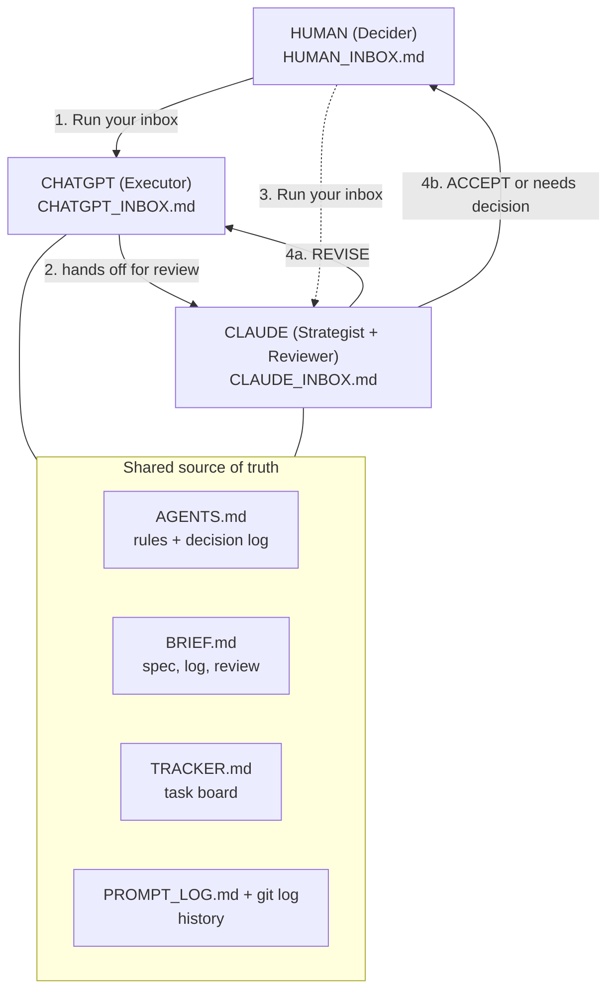

# Multi-Agent Setup

A reusable seed file for starting any project with a **Human + Claude + ChatGPT** working framework.

**You decide. Claude thinks and reviews. ChatGPT executes.**

## What's in this repo

| File | Purpose |
|---|---|
| [`multi-agent-setup.md`](multi-agent-setup.md) | The seed/template. Roles, principles, file structure, the inbox loop, RISEN+ prompt format, review standard, logging, bootstrap steps. |
| [`templates/`](templates/) | Ready-to-copy starter files: `AGENTS.md`, `CLAUDE.md`, `BRIEF.md`, `TRACKER.md`, `PROJECT_README.md` (becomes the new project's `README.md`), and `workflow/` (`CLAUDE_INBOX.md`, `CHATGPT_INBOX.md`, `HUMAN_INBOX.md`, `PROMPT_LOG.md`). Fill the `<placeholders>`. |
| `README.md` | This file: how to use the seed, plus a progress log. |

## How to use it

1. **Copy** `multi-agent-setup.md` into the root of a new (or existing) project folder.
2. **Tell an agent** (Claude or ChatGPT) something like:
   > Read `multi-agent-setup.md` and bootstrap the framework for this project.
3. The agent **asks you five questions** (goal and deliverables, deadline, which agents and their access, where existing materials are, hard rules). Answer briefly.
4. The agent creates the framework files (`AGENTS.md`, `CLAUDE.md`, `BRIEF.md`, `TRACKER.md`, `workflow/…`), writes the first spec and first task, and commits `[claude] SETUP: ...`.
5. From then on, **work in rounds**: say **"Run your inbox"** to one agent at a time.

```
You: "Run your inbox" -> ChatGPT executes   -> hands to Claude
You: "Run your inbox" -> Claude reviews     -> back to ChatGPT, or to you
You: answer / do the ownership pass         -> next round
```

**Faster start:** instead of letting the agent generate the files, copy the contents of `templates/` into your project root (rename `PROJECT_README.md` to `README.md`) and tell the agent to fill in the placeholders from your five answers.

### Diagram



An editable draw.io version is at [`diagrams/workflow.drawio`](diagrams/workflow.drawio). Open it at [app.diagrams.net](https://app.diagrams.net) (File > Open from > Device), or with the draw.io extension in VS Code.

### Day to day

- Your to-do list is one file: `workflow/HUMAN_INBOX.md`.
- Your decisions live in the decision log in `AGENTS.md`.
- To trace anything: read `workflow/PROMPT_LOG.md` or run `git log --oneline`.
- You can interrupt at any time by writing `FROM: USER` at the top of any inbox. Your message overrides the agents.

### Once the project is running

The seed file stays as the template. If a project already has `AGENTS.md` and a `workflow/` folder, agents follow `AGENTS.md` instead of re-bootstrapping.

## Adapting by task type

Section 11 of the seed covers folder layouts and what "done" means for writing, research, coding and planning projects.

## Progress log

Newest first. Add a row whenever the seed or this repo changes.

| Date | Change |
|---|---|
| 2026-11-25 | Added workflow diagram: Mermaid in README plus editable `diagrams/workflow.drawio`. |
| 2026-11-25 | Added `templates/` (AGENTS, CLAUDE, BRIEF, TRACKER, PROJECT_README, workflow inboxes and prompt log). |
| 2026-11-25 | Added `multi-agent-setup.md` seed and this README. |

## Ideas / next steps

- Try the templates on a real project and tighten whatever felt clumsy.
- Record lessons learned from each new project run in section 13 of the seed.
